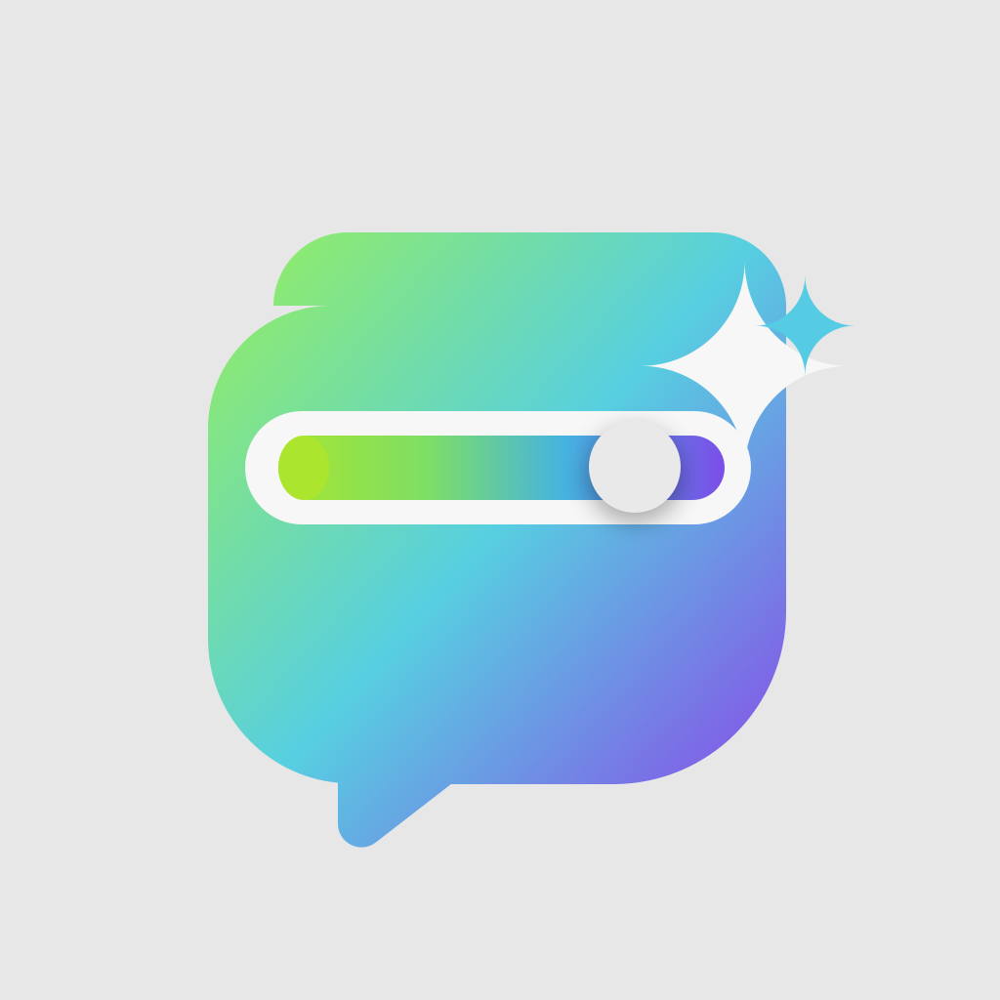
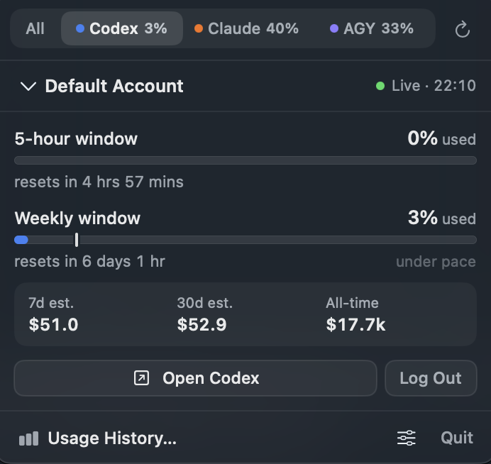

<p align="center">
  
</p>

<h1 align="center">CodexPeek</h1>

<p align="center">Codex, Claude Code and Antigravity usage in your macOS menu bar.</p>

<p align="center">
  macOS 14+ · Swift 6<br>
  <a href="#install">Install</a> ·
  <a href="Docs/USAGE.md">Data and estimates</a> ·
  <a href="https://github.com/20ns/CodexPeek/issues">Report a bug</a>
</p>

<p align="center">
  <a href="https://github.com/20ns/CodexPeek/actions/workflows/ci.yml"></a>
</p>

CodexPeek tracks your 5-hour and weekly limits, current usage, and reset times. Open Usage History for token counts and API-equivalent cost estimates by model.

The menu uses SwiftUI in a native popover, and the history window uses Swift Charts. There are no package dependencies, and the Codex helper runs only when needed.

<p align="center">
  
  
</p>

## What you can see

- **Codex:** 5-hour and weekly usage, reset countdowns, Spark limits when available, your active account and plan, and account switching from the menu.
- **Claude Code:** 5-hour and weekly usage, your plan, and per-model weekly limits such as Fable's.
- **Antigravity:** 5-hour and weekly quota for Gemini and Claude / GPT models, the separate Gemini Argon limit, and your Google AI plan.
- **Views:** Top tabs for each service's weekly usage, plus an All view combining every service.
- **Menu-bar icon:** Your chosen primary service, with other services optional.
- **Pace mark:** A marker on weekly bars. Staying below it means you can burn faster before the reset.
- **Token history:** Daily and hourly counts by model, including retained archived Codex sessions and Claude subagent logs.
- **Cost estimates:** Codex, Claude Code, Antigravity, or combined history with API-equivalent estimates for the last 7 days, 30 days, and all retained logs.

Usage refreshes every five minutes. Use the refresh button at the top right of the menu to update immediately.

Launch at Login is available in the app menu.

Dollar amounts estimate what recorded tokens would cost at API rates, not your subscription bill. Missing logs and unknown model prices can leave gaps.

## Install

Build from source for now. There are no published downloads on the [releases page](https://github.com/20ns/CodexPeek/releases) yet.

Requirements:

- macOS 14 or later and a Swift 6 toolchain.
- Sign-in for each service you use: the Codex CLI for Codex, a Claude Code account for Claude, and the Antigravity CLI (`agy`) for Antigravity quota.

Clone and build:

```sh
git clone https://github.com/20ns/CodexPeek.git
cd CodexPeek
./Scripts/build_app.sh
open .build/CodexPeek.app
```

To use Launch at Login, move `CodexPeek.app` from `.build` into `/Applications` and open it from there.

CodexPeek looks for `codex` on `PATH` and in common Homebrew and user install directories. To use another location, set `CODEX_CLI_PATH` when launching it:

```sh
CODEX_CLI_PATH=/path/to/codex .build/CodexPeek.app/Contents/MacOS/CodexPeek
```

The build scripts produce an unsigned app. If macOS blocks it, allow it in System Settings > Privacy & Security, then open it again. Signed and notarized releases are still planned.

## Where the data comes from

- **Codex limits:** Read via the local `codex app-server` protocol. CodexPeek starts a process for each refresh and stops it afterward. If that fails, it falls back to local session data or a saved snapshot and marks the result as an estimate.
- **Claude limits:** Fetched from Anthropic's usage endpoint using your existing Claude Code credentials. An optional status-line bridge can update readings between refreshes. This endpoint is not a documented public API, so changes to it may require an app update.
- **Antigravity limits:** Read from the `agy` CLI's local `/usage` command, which uses no tokens. CodexPeek runs it only after local Antigravity activity, after a quota reset, or once an hour, keeping it current when you use Antigravity through the app or ACP.
- **Token history and cost estimates:** Parsed on your Mac from local session logs, including Antigravity app, CLI and ACP transcripts. Unchanged files are cached between scans.

See [data and estimates](Docs/USAGE.md) for account behavior, credential handling, refresh timing, pricing caveats, and the Claude status-line setup.

## Development

Run the app without packaging it:

```sh
swift run CodexPeek
```

Run the built-in checks:

```sh
swift run CodexPeek --self-test
./Scripts/check_auth_watcher.sh
./Scripts/check_refresh_cadence.sh
```

App builds go to `.build/CodexPeek.app`. Package a ZIP or DMG:

```sh
./Scripts/build_release.sh
./Scripts/build_dmg.sh
```

Both scripts run the self-tests first, then write `dist/CodexPeek.zip` and `dist/CodexPeek.dmg`. See the [release checklist](Docs/RELEASE.md) for publishing steps.

| Path | Contents |
| --- | --- |
| [Sources/CodexPeek](Sources/CodexPeek) | App, usage readers, history, and self-tests |
| [AppResources](AppResources) | App metadata and icon |
| [Scripts](Scripts) | Builds and regression checks |

## Contributing

Bug reports and pull requests are welcome.

When reporting a bug:

- Include your macOS version, how you installed CodexPeek, and the steps to reproduce the problem.
- Remove account details and tokens from anything you share.

When opening a pull request:

- Keep changes small.
- Reuse native controls and existing helpers.
- Avoid new dependencies where possible.
- Run the checks above before opening a PR.
